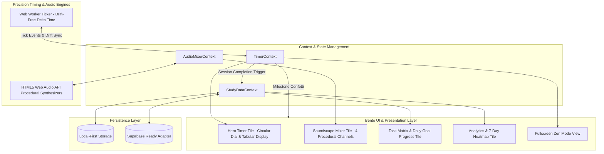

# Masterpiece Study Timer: Master Task Plan

This document details the complete roadmap and architecture for building the ambient, distraction-free **Masterpiece Study Timer** application.

---

## Architecture Overview

---

## Phase 0: Project Scaffolding & Environment Setup
- [ ] Initialize React + TypeScript with Vite.
- [ ] Configure Tailwind CSS with Obsidian palette tokens, custom fonts, and smooth spring easings.
- [ ] Configure Lucide React icons, Canvas-Confetti, and strictly-typed TypeScript declarations.
- [ ] Set up directory structure: `/components`, `/engine`, `/audio`, `/context`, `/hooks`, `/types`, `/utils`.
- [ ] Verify dev server boots cleanly with zero errors or warnings.

---

## Phase 1: Drift-Free Timer Engine
- [ ] **Web Worker Ticker (`timerWorker.ts`)**:
  - Independent background worker posting millisecond ticks to prevent browser throttling when tab is inactive.
  - High-accuracy delta calculation using `Date.now()` and `performance.now()`.
- [ ] **Timer State Machine (`timerEngine.ts`, `TimerContext.tsx`)**:
  - Modes:
    - **Classic Pomodoro**: 25 min work / 5 min short break / 15 min long break.
    - **Long Focus**: 50 min work / 10 min break.
    - **Flowmodoro**: Continuous count-up stopwatch with proportional break accrual.
    - **Custom Mode**: Fully configurable focus/break intervals.
  - Controls: `Start`, `Pause`, `Resume`, `Skip`, `Reset`, and `+5m Quick Extend`.
  - Auto-cycle option between work and break sessions.
  - Document title and favicon dynamic countdown updater.

---

## Phase 2: Procedural Ambient Soundscape (Web Audio API)
- [ ] **Audio Engine (`audioContext.ts`, `synthesizers.ts`)**:
  - Zero external CDN audio files (100% native Web Audio API procedural synthesis).
  - **4 Synthetic Generators**:
    1. *Binaural 40Hz Beat*: Dual sine wave oscillators (e.g. 200Hz left, 240Hz right) stimulating gamma brainwave focus.
    2. *Rainfall*: Pink/white noise buffer through high-pass/low-pass biquad filters with randomized droplet transients.
    3. *Pink Noise*: Paul Kellet 1/f noise filter network producing calm acoustic masking.
    4. *Café Ambience*: Multi-layered filtered noise passing through resonant formant filters mimicking distant murmur.
- [ ] **Mixer Architecture (`AudioContext.tsx`, `SoundscapeTile.tsx`)**:
  - Independent volume faders (0-100%) for each generator.
  - Real-time audio activity indicator lights (pulsing when generator active).
  - Anti-pop smooth gain ramping (80ms exponential ramp).
  - Global Master Mute toggle (`M` shortcut).

---

## Phase 3: Bento UI Layout, Zero CLS & Fullscreen Zen Mode
- [ ] **Bento Grid Architecture (`BentoGrid.tsx`)**:
  - Responsive 12-column layout adhering strictly to `ui_ux_guidelines.md`.
  - Obsidian glass aesthetic (`#060709` canvas, `#101217` bento tiles, `rgba(255,255,255,0.06)` borders).
  - Radial neon glows (`#6366F1` Focus, `#10B981` Emerald, `#06B6D4` Cyan).
- [ ] **Zero Cumulative Layout Shift (CLS = 0.00)**:
  - Tabular monospace numbers (`font-mono`, `tabular-nums`) across all timer readouts.
  - Rigid bounding boxes on buttons, icons, and badges.
  - Constant viewBox SVG circular progress ring with silky `stroke-dashoffset` transition.
- [ ] **Micro-Interactions & Tactility**:
  - Spring-curve button depression (`scale(0.98)`).
  - Hover sheen & elevation transitions.
- [ ] **Fullscreen Zen Mode (`ZenOverlay.tsx`)**:
  - Activated via UI button or `F` hotkey.
  - Fades background bento tiles into pure obsidian void.
  - Enlarges glowing central dial with discreet hover-accessible sound fader bar.
- [ ] **Keyboard Shortcuts Matrix**:
  - `Space`: Start / Pause
  - `F`: Toggle Fullscreen Zen Mode
  - `M`: Toggle Master Mute
  - `Escape`: Exit Zen Mode

---

## Phase 4: Analytics, Task Tagging & Gamification
- [ ] **Task & Session Tagging (`TaskMatrixTile.tsx`)**:
  - Session tagging (e.g. "Deep Work", "Reading", "Revision", "Coding", "Writing").
  - Create, select, and filter active tags.
  - Daily goal tracker (e.g. Target: 4 hours, completed: 2h 45m).
- [ ] **Analytics Engine (`AnalyticsTile.tsx`)**:
  - 7-day focus intensity heatmap.
  - Session distribution bar charts (focus hours per tag).
  - Current streak and all-time deep work stats.
- [ ] **Celebration Engine (`confetti.ts`)**:
  - Non-intrusive particle confetti upon interval completion and daily goal attainment.
- [ ] **Data Persistence & Portability**:
  - Local-first persistence in `localStorage`.
  - Export / Import data as JSON.
  - Extensible data layer ready for Supabase sync.

